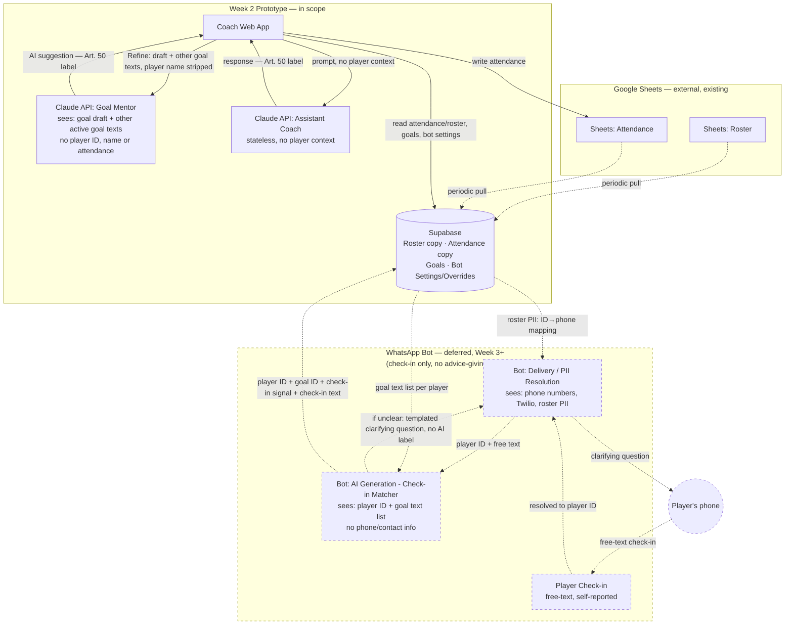

# CoachMate – Technical Architecture Diagram

Sep 28, 2026 · Updated Oct 8, 2026 (Goal Mentor input, check-in text storage, attendance write-back, goal retention) · Based on: Project Planning, Personas & User Stories, Customer Journey, Interview, Research Synthesis, Design Handoff

## Scope

Full target architecture (Week 2 prototype + Week 3+ deferred components), with deferred parts marked dashed.

## Diagram

## Decision Log

1. **Sheets vs. Supabase (roster & attendance):** Attendance is write-target Sheets, read-target periodic pull into Supabase (accepted staleness). Roster is periodic pull Sheets → Supabase. Goals and Bot Settings/overrides live only in Supabase. The sync is one-way (Sheets → Supabase) — avoids bidirectional sync/conflict resolution. The only write to Sheets is attendance marks taken in the app, written directly to the existing session column (changed cells only, column and player row looked up at save time); the app never creates Sheet columns, rows or sessions.
2. **Advice-giving (Bot Settings, Screen 6):** Removed from scope entirely. No component generates or sends unreviewed AI advice to players. This also removes the "strictest Art. 50 case" (no coach review gate) from the architecture. Consequence: the "Advice-giving" toggle should be removed from Screen 6 in the Design Handoff — only Passive/proactive and Adaptive-to-player toggles remain.
3. **PII boundary (WhatsApp bot):** Modeled as two separate boundary boxes/nodes rather than one — `BotMatcher` (AI-generation, sees player ID + goal text, never phone/contact info) and `BotDelivery` (delivery + ID→phone resolution, sees phone numbers/Twilio/roster PII, never message-generation logic). Chosen as the safer approach: least-privilege via structural separation rather than same-box internal discipline; matches the project's own "access rights assigned strictly per system" principle. Trade-off: stricter to build (real service boundary, not just a code module) — relevant for Week 3 scoping.
4. **Gender field:** Dropped from scope entirely — not modeled anywhere, no data-model or consent addition needed.
5. **Assistant Coach persistence:** Stateless — calls Claude API directly, no DB read/write, single session only.
6. **Player check-in:** Added as a new deferred flow (not present in the original Design Handoff, despite being implied by Project Planning and User Story 5). Free text, routed through `BotDelivery` (for ID resolution) into `BotMatcher` (for goal matching). `player ID + goal ID + check-in signal` and the raw check-in text are written to Supabase — the coach needs to read the actual message. Because that text can name third parties, it comes with a retention rule (STOP → deleted after a 7-day grace period; roster removal → deleted) and consent wording that covers storing it (`CLAUDE.md`, BotMatcher/BotDelivery section). *Changed from the original decision, which did not store the text.*
7. **Check-in matching AI:** Modeled as a separate node (`BotMatcher`), distinct from advice-generation, since goal-matching is a different task/prompt even though both would run on the same Claude API and avoid PII.
8. **Clarifying question (unclear check-in):** Templated/fixed wording with slots filled by the matcher's decision (e.g. goal names) — not freely LLM-generated text reaching the player. Treated as out of scope for Art. 50 labeling on that basis. If this is ever implemented as freely generated phrasing instead, it should be re-evaluated and labeled like the other AI outputs.
9. **Goal Mentor input (decided 2026-10-07, extended 2026-10-08):** Sends only the coach's goal draft and the player's other active goal texts. No player ID (allowed but not needed), no name, no attendance — a missed-session count says nothing about why, and read out in front of the player it can feel like judgement. Before sending, the server replaces the selected player's own name with "the player" in all sent text; other names rely on the static no-names caption. *Replaces the original "player ID + behavioral signals" design.* Spec: `documentation/AI goal mentor/`.
10. **Goal storage and retention (decided 2026-10-08):** Goals store text, `status` (active/completed), `created_at`, `updated_at`, `completed_at` — no score, priority, progress or AI-involvement flag (a static footnote covers Art. 50 instead). A player's goals are deleted when they are removed from the roster, matching the check-in text rule.

## Known Open Items (carried from Design Handoff, not resolved by this diagram)

- Whether the Week 2 pilot test (1–2 people) includes a player or is Alex only
- Whether the Assistant Coach should ever have team-specific memory/context (currently: no, per Decision 5)
- Full WhatsApp bot build timeline (Week 3+) and the build-effort implications of the two-boundary-box PII split (Decision 3)
