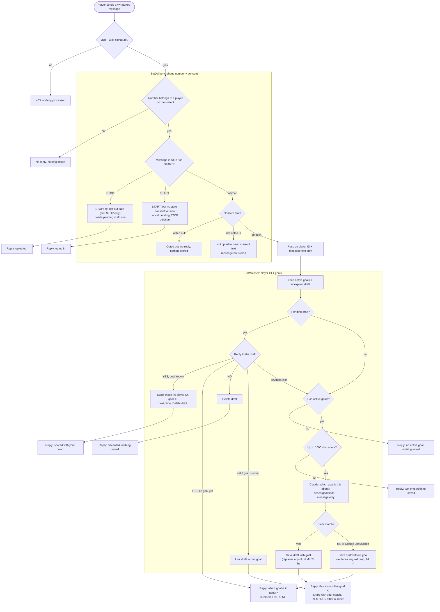
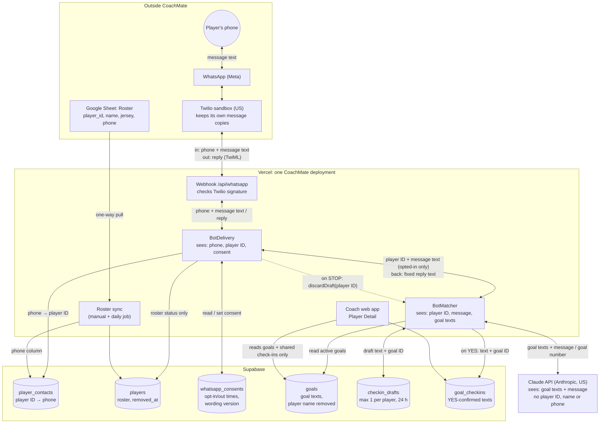
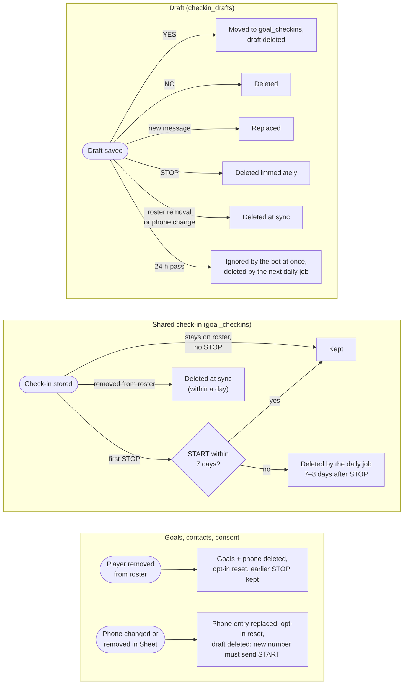

# CoachMate – WhatsApp Check-in Flowcharts

Oct 12, 2026 · Drawn from the built code (`app/api/whatsapp/route.ts`, `lib/bot-delivery.ts`, `lib/bot-matcher.ts`, `lib/checkin-flow.ts`, `lib/retention-purge.ts`, `lib/roster-sync.ts`) after the end-to-end sandbox test · Rules: `CLAUDE.md`, "BotMatcher / BotDelivery Boundary Split"

Three charts, one question each:

1. **Process:** what happens to one incoming WhatsApp message.
2. **Data flow:** which component sees and stores which data.
3. **Retention:** when stored check-in data is deleted.

## 1. Process: one incoming message

Every reply is fixed, templated text (`lib/bot-consent.ts`, `lib/checkin-flow.ts`). Claude only returns a goal number.

Not shown: if the database or anything else fails inside BotMatcher, the player gets "can't process updates right now, nothing was saved".

## 2. Data flow: who sees and stores what

The webhook route is the only place that holds both the phone number and the message text. It resolves the player ID and passes the text on.

What the coach never sees: phone numbers, drafts, and whether or when a player joined or sent STOP (decided 2026-10-12).

The split is enforced in code (`lib/bot-boundary.test.ts`), not by the database: both sides use the same service-role key in one deployment. This is an accepted residual risk (`CLAUDE.md`, "Residual risk").

## 3. Retention: when check-in data is deleted

The daily job (`/api/cron/retention`, 03:00 UTC) first runs the roster sync, then the purge. A manual sync from the app applies roster removals at once.

Whole rows are deleted: there is no separate step that redacts third-party names inside a check-in. Copies held by Twilio, WhatsApp (Meta) and Anthropic follow their own retention rules, not these.
